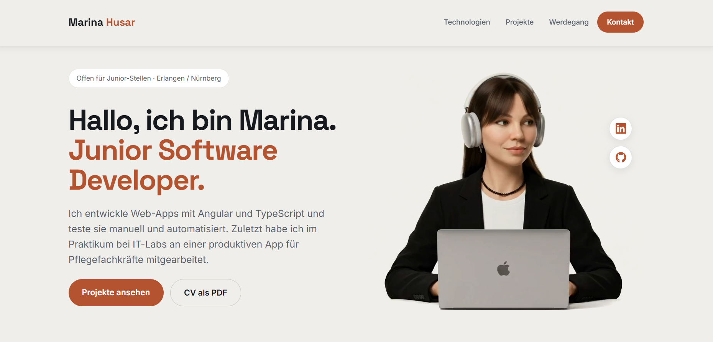
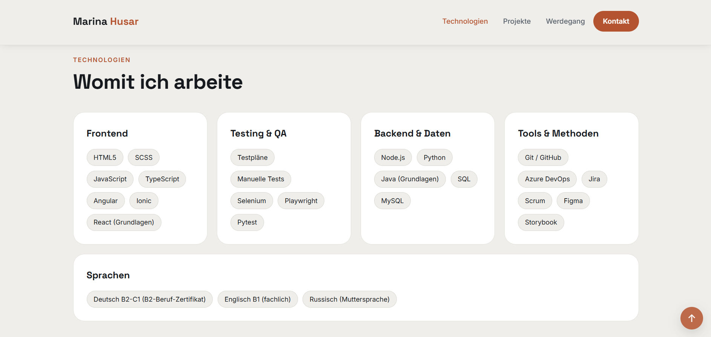
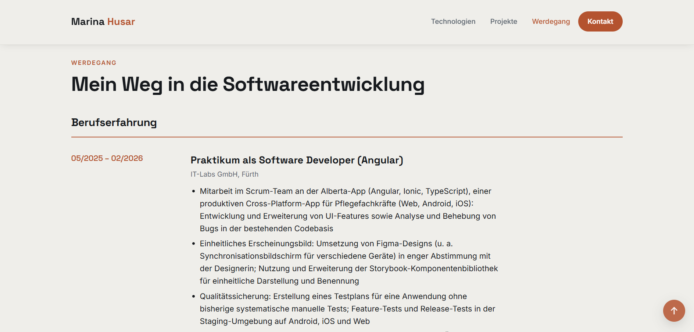
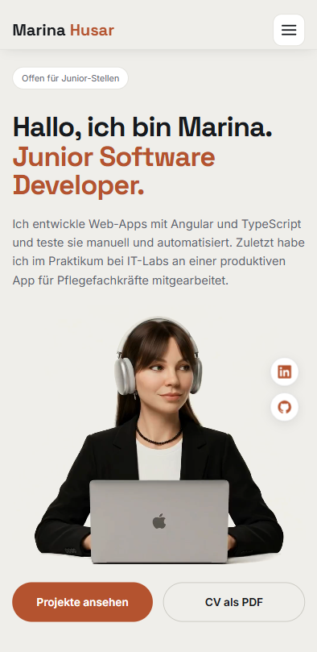
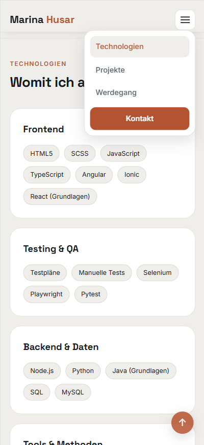

# Portfolio – Marina Husar

Persönliche Portfolio-Website mit Projekten, Technologien und Werdegang. Als Lernprojekt mit Angular und TypeScript entwickelt.



## Besonderheiten

- **Interaktiver Avatar:** Der Kopf folgt dem Mauszeiger. Dafür wird ein Video je nach Cursorposition an die passende Stelle gespult und weich angefahren.
- **Handy und Tablet:** Ohne Maus dreht sich der Kopf von allein ruhig hin und her.
- **Responsives Layout:** Auf großen Bildschirmen steht der Text links und der Avatar rechts, auf dem Handy untereinander. Auf kleinen Geräten gibt es ein Burger-Menü.
- **Navigation:** Der aktuelle Abschnitt wird im Menü hervorgehoben, ein Button führt zurück zum Seitenanfang.
- **Werdegang:** Getrennt nach Berufserfahrung und Ausbildung.
- **Links:** Über die Icons neben dem Avatar und im Kontaktbereich gelangt man direkt zu LinkedIn und GitHub.
- **Lebenslauf:** Als PDF zum Download.

## Technologien

- **Entwicklung:** Angular, TypeScript, HTML5, SCSS
- **Layout:** CSS Grid, Flexbox und Media Queries für die Darstellung auf Handy, Tablet und Desktop
- **Avatar:** erstellt mit Gemini und Kling, Entwicklung mit Unterstützung von Claude
- **Versionsverwaltung:** Git und GitHub

## Screenshots

### Desktop







### Mobil

| Ansicht                           | Burger-Menü                           |
| --------------------------------- | ------------------------------------- |
|  |  |

## Lokal starten

```bash
npm install
ng serve
```

Danach ist die Seite unter `http://localhost:4200` erreichbar.

## Aufbau

- `src/app/app.ts`: Daten (Technologien, Projekte, Werdegang) und Logik (Menü, Scroll-Hervorhebung, Avatar-Steuerung)
- `src/app/app.html`: Aufbau der Seite
- `src/app/app.scss`: Gestaltung und responsives Layout
- `public/`: Avatar-Video, Bilder und Lebenslauf als PDF
