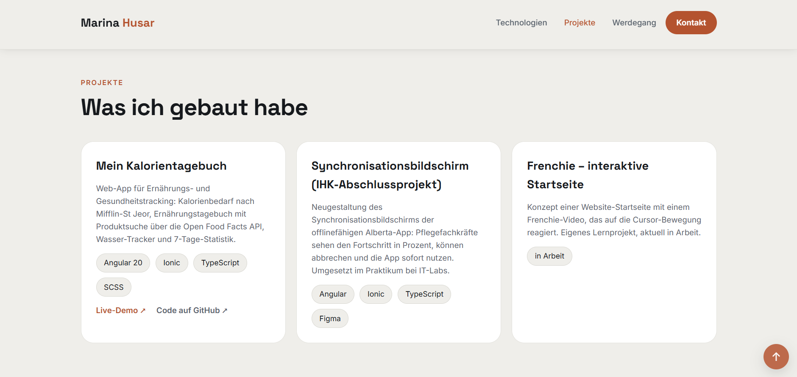
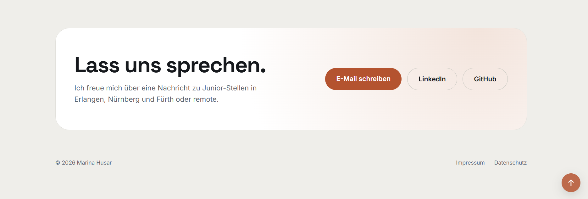

# Portfolio – Marina Husar

Persönliche Portfolio-Website mit Projekten, Technologien und Werdegang. Als Lernprojekt mit Angular und TypeScript entwickelt.


## Besonderheiten

- **Interaktiver Avatar:** Der Kopf folgt dem Mauszeiger. Dafür wird ein Video je nach Cursorposition an die passende Stelle gespult und weich angefahren.
- **Handy und Tablet:** Ohne Maus dreht sich der Kopf von allein ruhig hin und her.
- **Responsives Layout:** Eine Spalte auf dem Handy, zwei Spalten auf großen Bildschirmen, Burger-Menü auf kleinen Geräten.
- **Navigation:** Der aktuelle Abschnitt wird im Menü hervorgehoben, ein Button führt zurück zum Seitenanfang.
- **Werdegang:** Getrennt nach Berufserfahrung und Ausbildung.
- **Lebenslauf:** Als PDF zum Download.

## Technologien

- **Frontend:** HTML5, SCSS, JavaScript, TypeScript, Angular, Ionic, React (Grundlagen)
- **Testing & QA:** Testpläne, manuelle Tests, Selenium, Playwright, Pytest
- **Backend & Daten:** Node.js, Python, Java (Grundlagen), SQL, MySQL
- **Tools & Methoden:** Git / GitHub, Azure DevOps, Jira, Scrum, Figma, Storybook

## Screenshots

### Desktop







### Mobil

| Ansicht                           | Burger-Menü                           |
| --------------------------------- | ------------------------------------- |
|  |  |

## Lokal starten

```bash
npm install
ng serve
```

Danach ist die Seite unter `http://localhost:4200` erreichbar.

## Aufbau

- `src/app/app.ts`: Daten (Technologien, Projekte, Werdegang) und Logik (Menü, Scroll-Hervorhebung, Avatar-Steuerung)
- `src/app/app.html`: Aufbau der Seite
- `src/app/app.scss`: Gestaltung und responsives Layout
- `public/`: Avatar-Video, Bilder und Lebenslauf als PDF

## Kontakt

Ich freue mich über eine Nachricht zu Junior-Stellen in Erlangen, Nürnberg und Fürth oder remote.

- [LinkedIn](https://www.linkedin.com/in/marina-husar)
- [GitHub](https://github.com/MarinaHusar)
